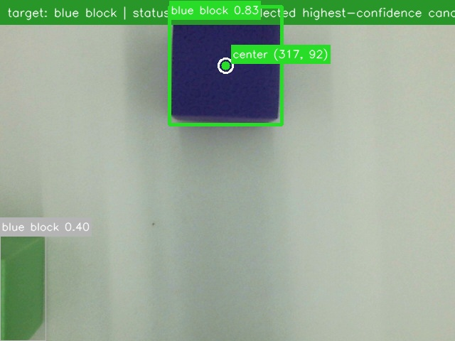
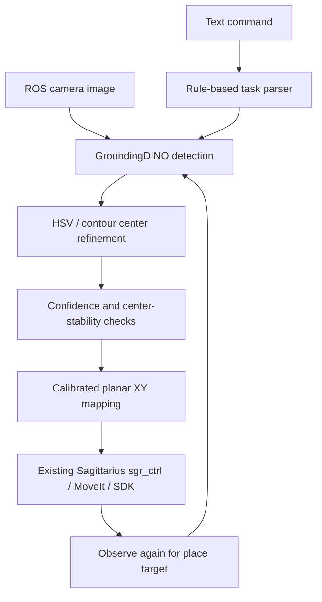

# Sagittarius Semantic Grasp

Language-guided pick/place on a **real Sagittarius robotic arm**, integrating GroundingDINO perception with ROS1 Noetic, calibrated image-to-plane mapping, and the existing Sagittarius MoveIt / SDK / `sgr_ctrl` execution chain.

A rule-based parser turns a prompt such as `pick blue block and place it into red bucket` into pick and place targets. The arm observes again before placement. This is a tabletop manipulation prototype; it does not use an LLM planner.

## Real-robot demos

| Demo | Recording | What it demonstrates |
| --- | --- | --- |
| Single-target pick/place | [Watch Demo 1](https://www.youtube.com/watch?v=4V7Y5Qn2Jmw) | Blue block → red bucket, reported completed in the original demo notes. |
| Same-color stress test | [Watch Demo 2](https://www.youtube.com/watch?v=vSotKdQC2tA) | Blue step completed; red placement rejected with incomplete detection; green placement deliberately disrupted by moving the bucket, then rejected. The rejected tasks failed to complete. |
| Palm placement | [Watch Demo 3](https://www.youtube.com/watch?v=i96AO-EEe4g) | A reported placement onto a palm using a language prompt. One illustrative example, with no generalization or human-interaction safety benchmark. |

These are the three original recordings, not new runs. Video outcomes above follow the [original demo descriptions](https://github.com/Block-O2/sagittarius-semantic-grasp/blob/a46ca3bd5ac2de44d2b20c44a63d4438e10b1cbf/README.md#demo); playback could not be independently rechecked during the November 2026 documentation audit. See the [evidence notes](docs/evidence.md) for provenance and separate experiment results.

[](artifacts/2026-04-26-front-hsv-refinement/README.md)

*Original 640×480 camera snapshot from the April 26 experiment. It shows detection output, not a completed pick/place or a frame from the linked videos.*

## My contributions

My work extended the Sagittarius color-grasping examples into a semantic perception-to-execution pipeline:

- Integrated GroundingDINO behind a replaceable perception backend and added the `/grasp_target_text` command interface.
- Added rule-based parsing for single-target, explicit pick/place, multi-step, same-color, and relative-placement commands.
- Connected target selection, confidence filtering, stable-frame checks, pixel-to-plane mapping, and action dispatch.
- Added HSV/contour center refinement inside selected boxes for known colors, with box-center fallback when refinement is unavailable.
- Added manual calibration workflows and separate `pick_front` / `place_front` configurations; tested the front-view pipeline on the physical arm and preserved failure evidence.

The robot SDK, robot model, MoveIt configuration, and original color-grasping / `sgr_ctrl` control backbone come from the Sagittarius ecosystem. This work integrates and extends that chain; it does not implement a hardware control framework from scratch. See [Attribution](docs/attribution.md).

## Architecture



The same center definition is used for calibration and runtime. The mapping estimates planar XY; heights and observation poses are configured, not inferred as full 3D geometry. [Source map and state flow →](docs/architecture.md)

## Representative recorded result

The [April 26 log excerpt](artifacts/2026-04-26-front-hsv-refinement/language_guided_grasp_node_excerpt.log) records one same-color sequence:

| Step | Recorded outcome |
| --- | --- |
| Red block → red bucket | Grasp and dynamic-place actions returned success. |
| Blue block → blue bucket | Grasp and dynamic-place actions returned success. |
| Green block → green bucket | Grasp returned success; place target was not found and the request was rejected. |

This experiment is **separate from Demo 2**. Action success is not an independently measured placement-accuracy score. Neither this excerpt nor the three selected videos establishes a task success rate. Refusing an unreliable placement is useful failure behavior, not successful task completion. [Evidence and limitations →](docs/evidence.md)

## Reproduction entry points

Start from the repository root:

```bash
git clone https://github.com/Block-O2/sagittarius-semantic-grasp.git
cd sagittarius-semantic-grasp
python3 tools/offline_smoke.py
```

The smoke check uses only the Python standard library, synthetic detections, and pure helper modules. It does not start ROS, load a model, access a camera, or send motion commands.

| Goal | Guide |
| --- | --- |
| Install ROS / MoveIt / model dependencies; build the catkin workspace | [Environment and setup](docs/setup.md) |
| Fit or inspect calibration and connect USB / camera devices | [Calibration](docs/calibration.md) · [Device troubleshooting](docs/troubleshooting.md) |
| Run offline perception, then an operator-controlled robot session | [Testing and running](docs/testing-and-running.md) |
| Inspect logs, media provenance, and validation limits | [Evidence](docs/evidence.md) · [November audit](docs/validation-20261105.md) |
| Read original Chinese implementation and operating notes | [历史技术记录](docs/history/README.zh-CN-20260426.md) · [Work log](WORKLOG.md) |

**Launcher caveat:** `execute_grasp:=false` disables the language node's action client, but the existing launch files still start the robot SDK and `sgr_ctrl`, whose initialization can move the arm. Even `language_guided_grasp_image_test.launch` includes the real execution stack. Use the offline checks before any hardware session; read the launch guide before starting ROS.

## Known limits

- Front-view pick/place is the demonstrated setup. Left/right configurations exist but do not establish validated multi-view operation.
- Planar mapping and fixed heights suit the calibrated tabletop. There is no depth-based 6D pose estimation or open-scene grasping validation.
- Placement depends on target visibility after grasping. Prompt wording, lighting, occlusion, center fallback, and calibration affect behavior.
- Confidence and stable-frame checks gate requests; they do not guarantee collision avoidance, correct object identity, or complete task success.
- Rule-based task sequencing is limited to supported patterns. Same-color expansion uses fixed red/blue/green pairs, not scene-wide reasoning or an autonomous LLM agent.
- Model/checkpoint versions and the full historical environment are not locked. The latest audit ran no physical robot or full ROS/CUDA reproduction.

## Attribution and license

The existing [BSD-3-Clause LICENSE](LICENSE) retains NXROBO's copyright notice unchanged. Project integration and third-party components have distinct provenance; ROS, MoveIt, GroundingDINO, and external weights retain their own terms. See [component attribution and unresolved package metadata](docs/attribution.md).
